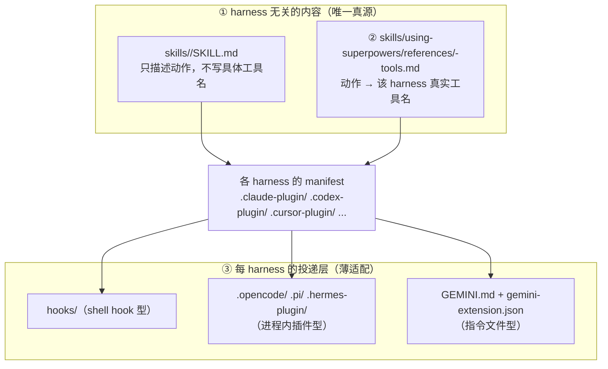
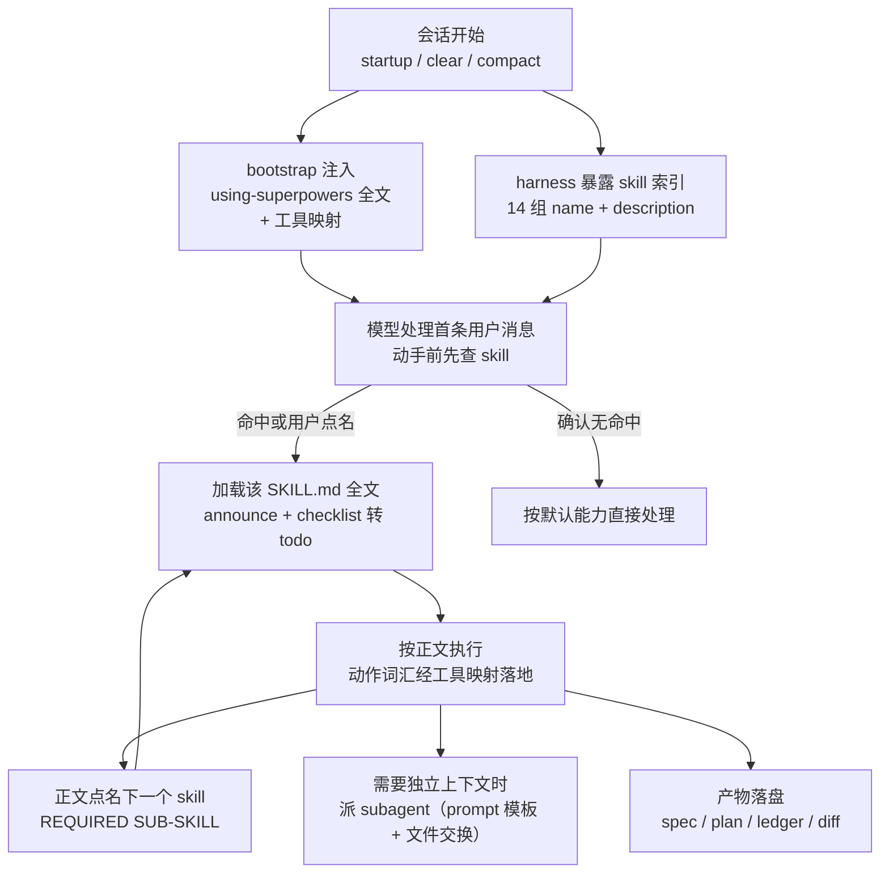
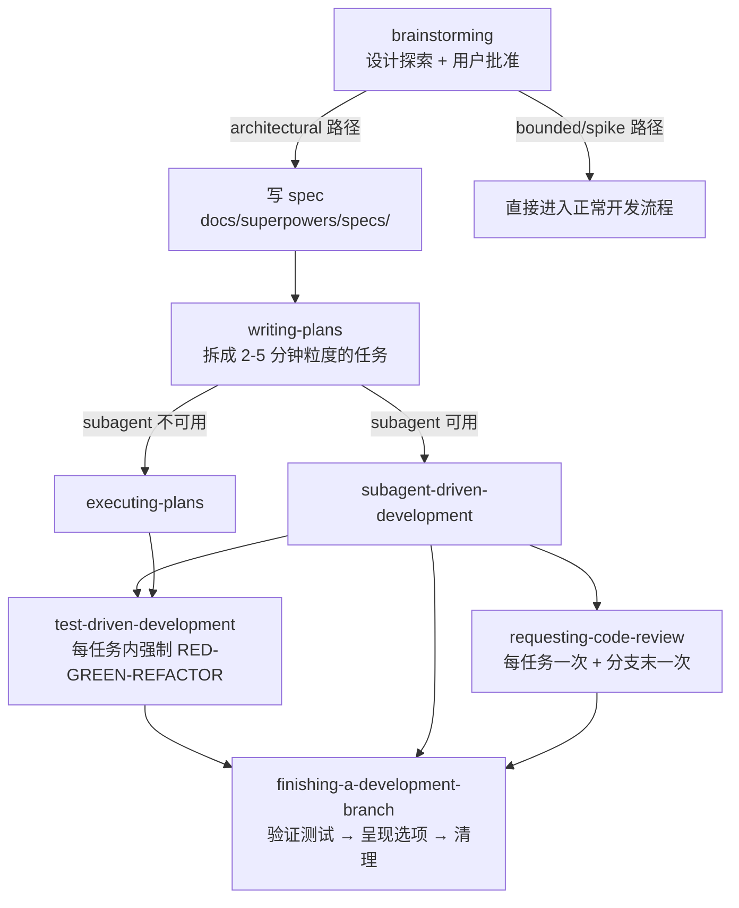
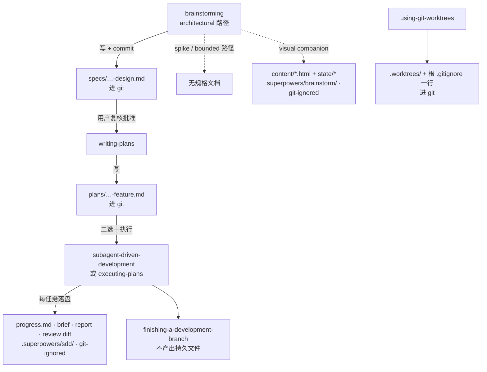

# Superpowers 源码研读笔记

> 对象仓库：`obra/superpowers`（SDD = Spec-Driven Development 工具，v6.3.0）
> 笔记来源：对 `skills/`、`hooks/`、`scripts/`、各 harness 专用目录、`docs/` 与 `RELEASE-NOTES.md` 的通读
> 关键参考文档：`docs/porting-to-a-new-harness.md`（理解整个架构的钥匙）、`CLAUDE.md`（贡献者/AI 规则）、`.github/PULL_REQUEST_TEMPLATE.md`

---

## 0. TL;DR 核心结论

| 问题                                 | 结论                                                                                                               |
| ------------------------------------ | ------------------------------------------------------------------------------------------------------------------ |
| Superpowers 本质是什么               | 一套**内容（skills）+ 投递层（bootstrap 注入）** 的开发方法论，不是命令集                                    |
| 内容载体                             | `skills/` 是唯一真源，跨 harness **逐字共享**                                                              |
| 生效条件                             | **两条腿**：① bootstrap 在每次会话开始时注入 ② harness 能发现/invoke skill。缺任一条 → skill 文件是"死重" |
| 让 skill 活起来的是什么              | `using-superpowers` 的 bootstrap 注入，而非 skill 本身                                                           |
| 是否需要 slash command               | **否**，v5.1.0 起已彻底删除；靠 skill description 语义匹配自动触发                                           |
| 能否直接拷贝`skills/` 到目标目录用 | 可作为实验起点，但**达不到可用标准**（丢 bootstrap、丢工具映射、丢 `superpowers:` 命名空间）               |
| 规范文件生产者                       | 只有`brainstorming`（spec）和 `writing-plans`（plan）产出"进 git 的文档"                                       |

---

## 1. 仓库结构

---

### 1.1 `hooks/` —— shell-hook 型 harness 的 bootstrap 注入器

| 文件                        | 作用                                                                                                                                                                                                                                                                              |
| --------------------------- | --------------------------------------------------------------------------------------------------------------------------------------------------------------------------------------------------------------------------------------------------------------------------------- |
| `hooks/hooks.json`        | **Claude Code** hook 配置。`SessionStart`，matcher = `startup\|clear\|compact`（**刻意不含 `resume`**），命令 `"${CLAUDE_PLUGIN_ROOT}/hooks/run-hook.cmd" session-start`，`"shell": "bash"`，`async: false`（必须同步，否则首轮可能在注入前就开始 — #571） |
| `hooks/hooks-cursor.json` | **Cursor** 变体，schema 完全不同：`{"version":1,"hooks":{"sessionStart":[{"command":"./hooks/run-hook.cmd session-start"}]}}` —— 小写 `sessionStart`、相对路径、无 `matcher`/`type`/`async`                                                                     |
| `hooks/run-hook.cmd`      | **polyglot 分发器**（同一文件既是合法 batch 又是合法 bash）。Windows 上依次尝试 `C:\Program Files\Git\bin\bash.exe` → `Program Files (x86)` → PATH 上的 `bash`；找不到 bash 则 `exit /b 0` 静默退出（harness 仍可用，仅无注入）                                   |
| `hooks/session-start`     | **真正的注入逻辑**。**无扩展名是刻意的**：Claude Code 在 Windows 会给含 `.sh` 的命令自动前置 `bash`，会造成重复调用                                                                                                                                               |

#### `session-start` 的三分支输出（最易踩的坑）

| 判断条件                                             | 输出形状                                                                                     | 平台                   |
| ---------------------------------------------------- | -------------------------------------------------------------------------------------------- | ---------------------- |
| `CURSOR_PLUGIN_ROOT` 已设置                        | `{ "additional_context": "…" }`                                                           | Cursor                 |
| `CLAUDE_PLUGIN_ROOT` 设置且 `COPILOT_CLI` 未设置 | `{ "hookSpecificOutput": { "hookEventName": "SessionStart", "additionalContext": "…" } }` | Claude Code            |
| 其他                                                 | `{ "additionalContext": "…" }`                                                            | Copilot CLI / SDK 标准 |

> **为什么必须严格只输出一个字段**：Claude Code 会同时读 `additional_context` 和 `hookSpecificOutput` 且**不去重**，同时输出会**双重注入**。

其他实现细节：

- 用 `${s//old/new}` 参数替换做 JSON 转义（曾用逐字符循环，在 Git Bash 上耗时 60s+）
- 用 `printf` 而非 heredoc（规避 bash 5.3+ heredoc hang，#571）
- 每个 `printf` 通过 `cat` 吸收 broken pipe（Windows 曾每会话报写错误，#1612）

### 1.2 `scripts/` —— 仓库维护脚本（与运行时无关）

| 脚本                                         | 作用                                                                                                                                                                                                                         |
| -------------------------------------------- | ---------------------------------------------------------------------------------------------------------------------------------------------------------------------------------------------------------------------------- |
| `bump-version.sh` + `.version-bump.json` | 按声明表同步所有 manifest 的 version（支持`plugins.0.version` 嵌套路径），并做仓库级漂移审计                                                                                                                               |
| `lint-shell.sh`                            | ShellCheck +`shfmt`，默认只查改动过的 shell 文件                                                                                                                                                                           |
| `sync-to-codex-plugin.sh`                  | 把受版本控制的插件文件 rsync 到外部 fork（`prime-radiant-inc/openai-codex-plugins`）的 `plugins/superpowers/`，提交并开 PR。带**锚定**的 EXCLUDES 列表（防止一个 harness 的 dotdir 泄漏到另一个 harness 的分发物） |
| `package-codex-plugin.sh`                  | 生成 Codex portal 上传用的确定性归档（归一化时间戳、保留执行权限、校验每个 skill 带 OpenAI 元数据、拒绝脏工作区）                                                                                                            |

### 1.3 `skills/` —— 内容本体

- **14 个 skill 目录**，**扁平命名空间**
- frontmatter **只有两个必需字段**：`name` + `description`（上限 1024 字符；其余字段见 agentskills.io 规范）
- `description` 规则（关键）：**只写触发条件，绝不概括流程**（见 §3.6）
- 支撑文件通过 SKILL.md 的**相对路径**引用，例：
  - `test-driven-development/SKILL.md` → `[writing-good-tests.md](writing-good-tests.md)`
  - `requesting-code-review/SKILL.md` → `[code-reviewer.md](code-reviewer.md)`
  - `subagent-driven-development/SKILL.md` → `./implementer-prompt.md`、`./task-reviewer-prompt.md`、`./re-review-prompt.md`、`../requesting-code-review/code-reviewer.md`
- **`skills/using-superpowers/`** 是入口，同时存放 `references/<harness>-tools.md`（现有 5 份：`codex`、`pi`、`gemini`、`antigravity`、`hermes`；这一层的完整拆解见 §2.1 的"② 层详解"）
- 隐式仓库根依赖（拷贝时需注意）：
  - `skills/brainstorming/scripts/server.cjs` 的 `readSuperpowersVersion()` 向上三级读 `package.json`，读不到再退 `.codex-plugin/plugin.json`
  - `skills/brainstorming/SKILL.md:250` 用的是**仓库根相对路径** `skills/brainstorming/visual-companion.md`（不是 `./`）
  - `skills/subagent-driven-development/scripts/*` 依赖 `git rev-parse --show-toplevel`

### 1.4 各 harness 专用目录

先看**集成形态**（Part 4 把形态分为 A/B/C 三类）：

| 目录 / 文件                                                     | Harness      | 形态                  | 关键内容                                                                                                                                                                                                                                                         |
| --------------------------------------------------------------- | ------------ | --------------------- | ---------------------------------------------------------------------------------------------------------------------------------------------------------------------------------------------------------------------------------------------------------------- |
| `.claude-plugin/plugin.json`                                  | Claude Code  | **A**           | **刻意不写 `skills`/`hooks` 字段** —— Claude 按约定自动发现 `skills/` 和 `hooks/hooks.json`。同目录 `marketplace.json` 为开发用 marketplace（`source: "./"`）                                                                                |
| `.cursor-plugin/plugin.json`                                  | Cursor       | **A**           | 显式`"skills": "./skills/"` + `"hooks": "./hooks/hooks-cursor.json"` —— **Shape A 的参考模板**                                                                                                                                                       |
| `.codex-plugin/plugin.json`                                   | Codex        | 无 hook               | 有`"skills": "./skills/"`；`"hooks": {}` 是**必须的空对象**：缺 `hooks` 字段时 Codex 会 fallback 去自动发现 `hooks/hooks.json`（即 Claude 的 SessionStart hook）。`[]`、缺字段、空内联列表都会 collapse 回 fallback，必须是 `{}`               |
| `.agents/plugins/marketplace.json`                            | Codex        | 分发                  | Codex marketplace 要求在 marketplace 根有此文件，否则能命名 marketplace 却找不到可安装条目                                                                                                                                                                       |
| `.opencode/plugins/superpowers.js` + `.opencode/INSTALL.md` | OpenCode     | **B**           | `config` hook 把 skills 目录 push 进 `config.skills.paths`（无需 symlink）；`experimental.chat.messages.transform` 把 bootstrap **作为 user message unshift 到首条用户消息**，用 `EXTREMELY_IMPORTANT` 标记去重，模块级缓存                        |
| `.pi/extensions/superpowers.ts`                               | pi           | **B**           | `resources_discover` → `skillPaths`；`session_start`/`session_compact` 置 `injectBootstrap=true`，`agent_end` 清掉；`context` 事件插入 user message 且**跳过开头的 compactionSummary**；模块级缓存。**无原生 skill 工具时的最佳参考** |
| `gemini-extension.json` + 根 `GEMINI.md`                    | Gemini CLI   | **C**           | manifest 用`"contextFileName": "GEMINI.md"`（**不写 skills 字段**，Gemini 自动发现随扩展打包的 `skills/`）；`GEMINI.md` 内容就两行 `@`-include                                                                                                     |
| `.kimi-plugin/plugin.json`                                    | Kimi Code    | 声明式                | `"skills": "./skills/"` + `"sessionStart": {"skill": "using-superpowers"}` + 内联 `skillInstructions`（工具映射）。无需 hook、无需拷贝、无 symlink                                                                                                         |
| `.devin-plugin/plugin.json`                                   | Devin CLI    | 无 hook               | 只有元数据；Devin 自动发现**同目录的** `skills/`，并在 system prompt 列出每个 skill 的 name+description，用原生 `skill` 工具调用                                                                                                                       |
| `.hermes-plugin/`（`plugin.yaml` + `__init__.py`）        | Hermes Agent | **B**（Python） | `provides_hooks: [pre_llm_call]`；`register(ctx)` 逐个 `ctx.register_skill(name, Path(skill_md))` —— **必须传 `pathlib.Path`**，传 `str` 会让 Hermes 静默禁用整个插件；`is_first_turn` 时 `return {"context": bootstrap}`                  |
| 根`package.json`                                              | pi           | B 的元数据            | `main` 指向 OpenCode 插件；`pi.extensions` / `pi.skills` 声明 pi 侧资源；`pi-package` keyword                                                                                                                                                            |
| `.version-bump.json`                                          | 全仓         | 发布                  | 列出所有带版本的 manifest 及其字段路径。**新 harness 若不登记就会发旧版本**                                                                                                                                                                                |

**两种注入策略的差异（Shape B 的坑）**：

- OpenCode 是**每 agent step** 都触发 transform → 靠**每次调用的去重 guard**
- pi 是**每 turn** 触发 → 靠**lifecycle flag + `agent_end` 重置**
- 把一方的去重策略套到另一方会破坏注入

### 1.5 `docs/` —— 文档，以及本仓库"自用"的产物

| 路径                                                          | 性质               | 内容                                                                                                       |
| ------------------------------------------------------------- | ------------------ | ---------------------------------------------------------------------------------------------------------- |
| `docs/porting-to-a-new-harness.md`                          | 架构说明           | 理解整个系统的钥匙（Part 1-3 讲原理，Part 4-8 讲移植流程，Appendix A/B 索引现有集成与 gotcha）             |
| `docs/testing.md`                                           | 工程说明           | `tests/`（插件代码测试）与 `evals/`（LLM 行为评测）的分工                                               |
| `docs/windows/polyglot-hooks.md`                            | 专题               | polyglot hook 分发器的由来                                                                                 |
| `docs/README.opencode.md`、`docs/README.kimi.md`          | 安装文档           | 各 harness 的安装步骤                                                                                      |
| `docs/superpowers/specs/`                                   | **本仓库自用产物** | 19 份设计规格                                                                                              |
| `docs/superpowers/plans/`                                   | **本仓库自用产物** | 15 份实施计划                                                                                              |
| `docs/plans/`                                               | 历史遗留           | 4 份（2025-11 ~ 2026-01），命名是 `-design.md` / `-implementation.md`，v4.x 起新产物统一到 `docs/superpowers/` |

#### 本仓库就是 superpowers 的第一个用户

`docs/superpowers/` 不是写给人读的说明书，而是**这套方法论作用在自己身上的产物**。四条证据：

1. **路径与命名逐字对上 skill 的规定**：`docs/superpowers/specs/YYYY-MM-DD-<topic>-design.md`、`docs/superpowers/plans/YYYY-MM-DD-<feature>.md` —— 正是 `brainstorming` 与 `writing-plans` 正文里写死的默认路径（§6.2）。
2. **plan 逐字套用 writing-plans 的模板**：开头就是 `> **For agentic workers:** REQUIRED SUB-SKILL: Use superpowers:subagent-driven-development (recommended) or superpowers:executing-plans …`，随后 `**Goal:**` / `**Architecture:**` / `**Tech Stack:**` / spec 路径 / `## Global Constraints` / `## File Structure` / `### Task N` + `- [ ]` 步骤。
3. **spec 把流程痕迹写在了文件里**：如 `2026-07-15-sdd-fix-loop-redesign-design.md` 的首部写着 `**Status:** Approved design (brainstormed with Jesse 2026-07-15); implementation plan to follow.` —— "brainstorming 批准 → 随后出 plan"这条链直接可见。
4. **时序对得上**：spec 先于 plan（`2026-08-05-hermes-version-bump-wiring-design.md` → `2026-08-06-hermes-version-bump-wiring.md`），同日成对也常见（`2026-07-15` 一对）。

统计上的两点偏差（也是真实运行的样子）：

- **15 份 plan 中 13 份有同名 spec**；缺的 2 份（`2026-05-07-pi-extension-and-evals`、`2026-06-09-visual-companion-issues`）从日期看是紧挨着上一个 spec 的后续工作。
- **19 份 spec 中 6 份没有对应 plan**：3 份 `platform-neutral-*` 三连、`positive-instruction-redesign`、`strict-cost-sdd`，以及 1 份 `...-eval-results.md` 衍生件。可见 spec 与 plan **不是一对一**：有的 spec 被并入别处执行，有的 spec 只是评测结论的载体。

另外，仓库根 `.gitignore` 里就有 `.worktrees/` 和 `.superpowers/` —— 正是 `using-git-worktrees` 与 SDD 要求的两个运行时位置（§6.3）。也就是说维护者自己也在这个仓库里跑 worktree + SDD。

**为什么这个事实值得记**：这 34 份文件是唯一公开可查的"真实运行日志"。skill 正文写的流程与它实际跑出来的样子，差别都在里面 —— 比如计划里用的是 `**Design spec:**` 而非模板的 `**Spec:**`，比如有 spec 没 plan。比只读 skill 更能判断"这套流程在真人手里长什么样"。

---

## 2. 架构和集成形态

参考仓库里的官方文档 `docs/porting-to-a-new-harness.md` Part 1。

### 2.1 三层结构



三层职责对应关系：

| #  | 组件                                 | 位置                                                       | 职责                                                                                                      |
| -- | ------------------------------------ | ---------------------------------------------------------- | --------------------------------------------------------------------------------------------------------- |
| ① | **Skills**（harness 无关）     | `skills/`                                                | 唯一真源，跨 harness**逐字共享**；只描述"动作"，从不点名工具                                        |
| ② | **Tool mapping**（每 harness） | `skills/using-superpowers/references/<harness>-tools.md` | 把动作词汇翻译成该 harness 的真实工具名；也可**内联进 bootstrap 注入器**                            |
| ③ | **Bootstrap**（每 harness）    | `hooks/`、`.opencode/`、`.pi/` 等投递层              | 会话开始时把`using-superpowers/SKILL.md` 全文包进 `<EXTREMELY_IMPORTANT>`，连同 ② 一起送进模型上下文 |

> **"The bootstrap is the entire integration."**
> 没有它：skill 文件存在于磁盘，但永远不会在正确时机被调用。

#### ② 层详解：工具映射（`references/<harness>-tools.md`）

上图里的 ② 就是 **`skills/using-superpowers/references/`** 这个目录 —— 五份文件，本质是一层"动词词典"。它被画在 ① 的框内是因为**它和 skills 一样随 skill 目录分发、跨 harness 共用同一个仓库来源**；但它的**内容**恰恰是 per-harness 的，这正是它单独成层的原因。

**它解决的问题**：`skills/*/SKILL.md` 里只写动作（*"dispatch a subagent"*、*"create a todo"*、*"read a file"*、*"invoke a skill"*、*"your instructions file"*），一个字都不提工具名（§2.2 规则 1）。模型知道"该做什么动作"，至于在这个 harness 上具体按哪个按钮，由映射文件翻译。

| 文件                         | Harness           | 覆盖要点（均摘自文件本身）                                                                                                                                                                                                                                             | 是否另有内联副本                                       |
| ---------------------------- | ----------------- | ------------------------------------------------------------------------------------------------------------------------------------------------------------------------------------------------------------------------------------------------------------------------ | -------------------------------------------------------- |
| `codex-tools.md`           | Codex             | 需在 `~/.codex/config.toml` 开 `[features] multi_agent = true`；`spawn_agent {fork_turns: "none"}` 才拿到干净上下文（默认 `"all"` 会灌入整份 transcript）；fix 轮用 `followup_task` 续原 implementer；V2 无 `close_agent`；模型名必须先对 spawn allowlist；`wait_agent` 是**事件订阅**而非轮询，用 5-10 分钟有界长等待；附 `GIT_DIR`/`GIT_COMMON` 环境探测片段 | 否                                                       |
| `pi-tools.md`              | pi                | 核心无 subagent 工具 → 装了 `pi-subagents` 就用 `subagent`，没装就顺序执行、**不许编造 `Task` 调用**；无 todo 工具 → 退回 plan 文件 / Markdown 清单 / `TODO.md`；`TodoWrite` 一律当作"任务跟踪"这个动作                                                                          | **是**（`piToolMapping()` 内联进 bootstrap，两处需同步） |
| `gemini-tools.md`          | Gemini CLI        | 完整名字表（`read_file`/`replace`/`run_shell_command`/`activate_skill`…）；subagent = `invoke_agent` + `agent_name: "generalist"`（或 `@generalist` 语法）；模板占位符必须先填满再传；并行 = 同一响应里多个 `invoke_agent`；另注 `GEMINI.md` 是"指令文件"、个人 skill 目录 `~/.gemini/skills/`（`~/.agents/skills/` 是跨运行时别名且优先） | 否（经 `GEMINI.md` 的 `@`-include 常驻）                |
| `antigravity-tools.md`     | Antigravity (`agy`) | subagent = `invoke_subagent` + 内置 `TypeName`（`self` 全能力 / `research` 只读）；**没有 todo 工具** → 用 `write_to_file` 的 task artifact（`IsArtifact: true`）当清单，`manage_task` 只管后台进程、不是清单                                                                   | 否（经安装器生成的 context file）                        |
| `hermes-tools.md`          | Hermes Agent      | `delegate_task(role="leaf")`；`skill_view("name")` 调 skill，catalog 未注册时**退回直接 `read_file` SKILL.md**；`todo` 工具；指令文件是 `AGENTS.md` / `~/.hermes/SOUL.md`                                                                                                | 否（`pre_llm_call` 首轮回传 bootstrap 时附带）           |

**没有 `claude-tools.md` 是刻意的**：Claude Code 的工具面（`Task`、`TodoWrite`、`Read`/`Edit`、`Bash`…）与 skill 里的动作词汇基本同名，Cursor / Copilot CLI 又共用同一工具面 —— 所以这三个 harness 干脆不在上表里，§8.3 记作"无需适配文件"。

**映射文件里装的不止一张名字表**，实际有四类内容：

1. **动作 → 工具名**：*"invoke a skill" → `activate_skill`*、*"search file contents" → `grep_search`*。
2. **能力缺失时的退化路径**：pi 无 subagent 工具 → 顺序执行而非编造调用；antigravity 无 todo 工具 → task artifact。写映射时必须**复用 skill 正文自带的 fallback 措辞**，不能自创 —— 这就是移植文档 Part 2 里 "Degradable" 的含义。
3. **harness 特有的开关与参数怪癖**：Codex 的 `multi_agent` / `fork_turns` / 模型 allowlist；Gemini 的占位符填充与并行规则。
4. **harness 特有的程序性补充**：`codex-tools.md` 里的 worktree 环境探测片段、沙箱禁 push 时改走 Codex App 原生按钮的收尾方式 —— 这类内容与"工具名"无关，但只有该 harness 需要。

**它在哪个位置，取决于集成形态**（同一份内容可能有多个落点）：

| 形态                                        | 映射放在哪                                                                       | 模型何时拿到                                   |
| ------------------------------------------- | -------------------------------------------------------------------------------- | ---------------------------------------------- |
| A（shell hook：Claude Code / Cursor / Copilot） | 只在 `references/`，**不**内联进 hook 输出                                      | 读到 `SKILL.md` 的 Platform Adaptation 指针后自己去读 |
| B（进程内插件：OpenCode / pi）              | 内联进 bootstrap 字符串（OpenCode 的 `toolMapping`、pi 的 `piToolMapping()`）；**pi 同时保留 `references/pi-tools.md`** | 每轮随 bootstrap 一起在上下文里                |
| C（指令文件：Gemini / Antigravity）         | `references/` 一份，由扩展自带的 context file `@`-include 或安装时生成           | 会话开始随指令文件加载                         |
| 声明式（Kimi Code）                         | manifest 内联 `skillInstructions`                                                | `sessionStart.skill` 加载 skill 时一并注入     |

三条由此推出的纪律：

- **双份必须同步。** pi 的映射存在两处（内联 + 文件），只改一处等于只改一半（§8.4 明确列为 gotcha）。
- **补映射 ≠ 改 skill。** 移植时唯一允许动 `SKILL.md` 的地方是 Platform Adaptation 的那行指针；把工具名写进正文属于违规（§2.2 规则 1，`CLAUDE.md` 的 "compliance changes" 拒收条款）。
- **新 harness 忘了登记就等于没映射。** 文件不存在时模型只能猜工具名 —— 这正是"发明不存在的工具"那类失败的来源（§2.5 诊断表的映射层）。

### 2.2 两条不可违反的规则

1. **Skills 只写动作，不写工具名。** 移植时**禁止**改 `skills/*/SKILL.md` 正文去适配工具名——修复属于"工具映射"。
   （唯一例外：`SKILL.md` 的 *Platform Adaptation* 指针清单可以加一行。）
2. **一切通过 harness 自己的安装机制投递，绝不改用户文件。** 不允许写 `~/.gemini/GEMINI.md`、`settings.json`、`~/.bashrc` 等。若安装机制确实无法承载 bootstrap，应**上报为限制**，而不是手改用户配置。

### 2.3 集成的前置硬条件

> **automatic session-start injection**：能在**每次会话开始**把文本注入模型上下文，且**不需要用户每会话 opt-in**。

可接受形式：hook/event 系统读 stdout；进程内插件/扩展的生命周期回调改消息数组；扩展**自带并声明**的 instructions 文件。

不可接受：需要用户粘贴 prompt / 跑命令 / 开启某模式。→ 验收测试必然失败。

### 2.4 三种集成形态

| 形态                                       | 特征                                                | 参考实现                                                                              |
| ------------------------------------------ | --------------------------------------------------- | ------------------------------------------------------------------------------------- |
| **A — Shell-hook**                  | hook 系统跑 shell 命令并读 stdout JSON              | Cursor（`hooks/session-start` + `hooks/hooks-cursor.json` + `.cursor-plugin/`） |
| **B — In-process plugin/extension** | JS/TS 模块暴露生命周期回调，代码里改消息数组        | OpenCode（`.opencode/`）；**无原生 skill 工具则抄 pi**                        |
| **C — Instructions-file**           | 只有始终加载的上下文文件（扩展自带、manifest 声明） | Gemini（`gemini-extension.json` + `GEMINI.md` + `references/gemini-tools.md`）  |

补充要点：

- **形态可组合**：skill 发现机制与 bootstrap 机制可以不同形态，但**两者都必须走安装机制**
- Codex/Devin 属"**surfaced skill index**"软路径：靠 harness 在会话开始暴露每个 skill 的 name+description 触发，**只 bootstrap 触发、不 bootstrap 工具映射**，且无结构保证
- "无 skill 系统"的 harness 需自备发现路径：生成 skill 索引（会过期）或指示运行时列举 `skills/*/SKILL.md`（推荐，永不过期）

### 2.5 整体工作机制：一次会话里到底发生了什么

把前三层拼起来，运行时其实只有**两条投递通道 + 一条靠模型自愿遵守的软约束**（1% 规则），没有任何中央调度器。

一句话版本：**bootstrap 负责"必须去查"，harness 的 skill 索引负责"能查到什么"，SKILL.md 正文负责"怎么做"，工具映射负责"用什么工具做"，文件负责"记住做到哪了"。**

#### ① 两条通道：一条常驻，一条按需

|              | 常驻通道（bootstrap）                                                                           | 按需通道（其余 skill）                                     |
| ------------ | ----------------------------------------------------------------------------------------------- | ---------------------------------------------------------- |
| 送的是什么   | `using-superpowers/SKILL.md` **全文**（Shape A 连 frontmatter 一起，约 60 行 / 485 词） | **只有** `name` + `description`（各一行）        |
| 怎么进上下文 | 投递层在 session start 主动注入，包在`<EXTREMELY_IMPORTANT>` 里                               | harness 的 skill 索引常驻；正文要模型调用 Skill 工具才加载 |
| 时机         | 每次会话、无条件、早于第一条用户消息                                                            | 模型判定"命中"之后                                         |
| 谁保证       | hook 读 stdout / 进程内插件改消息数组 / 扩展自带并声明的 context 文件                           | harness 的原生 skill 发现与调用能力                        |
| 缺了会怎样   | 整套系统退化为"磁盘上的文档"（§2.3 的硬条件，验收测试必挂）                                    | 只是这一个 skill 不触发，其他仍工作                        |

这就是**渐进式披露（progressive disclosure）**：常驻成本只有"一份元规则 + 14 行 description"，正文按需付费。

> **这里为什么突然提到 `writing-skills`？** 它和 bootstrap 之间**没有运行时关系** —— `using-superpowers` 不会调用它，它也不在任何一次会话的注入内容里。它是一个**编写期的元技能**（教人和 agent 怎么设计、测试、修改 skill，见 §5.4），只在"写 skill"这件事发生时生效。
> 它出现在这里，是因为上面那张表的分工反过来把 description 逼成了硬约束：模型只有那一行文字可用，**读不到正文就要能判断该不该加载**。于是 `writing-skills` 规定 description 只许写触发条件、不许概括流程，且限字数（§3.6）。一句话分工：**`writing-skills` 管"怎么写"，`using-superpowers` 管"必须去查"，两者不互相调用。**

#### ② 一次会话的完整时序



四个值得记住的性质：

1. **流程不在代码里。** 仓库没有 orchestrator、没有状态机、没有任务队列；`brainstorming → writing-plans → SDD/EP → finishing-a-development-branch` 这条主干，纯粹是各 skill 正文用 `REQUIRED SUB-SKILL` 互相点名串起来的（§4）。改流程 = 改 SKILL.md 正文，不动任何代码。
2. **"必须查 skill" 只对主 agent 生效。** 这条全局前置条件只存在于 bootstrap 里，并且被 `<SUBAGENT-STOP>` 显式豁免给 subagent（§3.5）——否则每个 subagent 都会想重走一遍完整流程。
3. **上下文是稀缺资源，所以状态外置。** 跨任务的状态一律落到文件：plan 里的 checkbox、SDD 的 `progress.md` 账本、review 包 diff。理由是正文原话 *"Conversation memory does not survive compaction"*（§5.2）。
4. **只有执行阶段是全自动的。** 全链路有五处必须停下来等人的决策点（路径分类、设计批准、worktree 同意、执行方式、分支收尾），见 §7.3。

#### ③ 分层的失败模式（诊断表）

| 层级                                        | 职责                               | 坏掉时的症状                                                                                       |
| ------------------------------------------- | ---------------------------------- | -------------------------------------------------------------------------------------------------- |
| 内容层 `skills/`                          | 定义"怎么做"                       | 能触发但流程走偏、步骤缺失                                                                         |
| **投递层** `hooks/`、`.opencode/` | 保证每次会话送达 bootstrap         | **完全不触发**：模型照常干活，只是永远不查 skill —— 唯一**静默失败**的层（最难发现） |
| 发现层（harness 的 skill 索引）             | 提供 name + description 与加载入口 | bootstrap 在，但模型不知道有哪些 skill → 靠猜、或反问用户"要不要用某流程"                         |
| 映射层 `references/<harness>-tools.md`    | 把动作翻译成真实工具名             | 模型说"我要派 subagent"却调不出工具，或发明不存在的工具名                                          |
| 模型层（遵守 1% 规则）                      | 在压力下真的去查                   | 触发率随模型能力波动 → 所以验收测试必须在目标模型上跑（§2.4 的"软路径"）                         |

> 这张表解释了 `docs/porting-to-a-new-harness.md` 为什么把 bootstrap 抬到"整个集成"的高度：**其余四层的故障都能在对话里看见，只有投递层坏了是无声的。**

### 2.6 能否直接把 `skills/` 拷到目标 Agent 的 skills 目录？

**可以当实验起点，但达不到可用标准**，会坏在四处：

1. **没 bootstrap ⇒ 不自动触发（最致命）。** `using-superpowers/SKILL.md` **不枚举**其他 skill，模型不知道有哪些、何时用
2. **工具映射缺失。** skill 只写动作；映射表在 `references/<harness>-tools.md`，而 `SKILL.md` 的 Platform Adaptation 只登记 Codex/Pi/Antigravity/Hermes
3. **命名空间与路径。** skill 间大量用 `superpowers:test-driven-development` 这类前缀（来自插件命名空间），拷到个人 skills 目录后失效；且存在仓库根相对路径
4. **配套脚本静默降级。** `server.cjs` 版本读到 `unknown`；`sdd-workspace` 等依赖 git 仓库根；`.version-bump.json` 版本一致性失效

**欲实验请按序补齐**：整棵树保结构复制 → 写目标 harness 的映射表 → **保证每次会话自动送达 bootstrap**（分水岭）→ 用验收提示验证。

**验收测试（PR 强制）**：干净会话发送

> Let's make a react todo list

`brainstorming` 必须在**任何代码之前**自动触发，并附完整 transcript。PR 模板明确列出的"不算真集成"：手工拷贝 skill 文件 / 用 `npx skills` 之类运行时 shim / 任何需要用户每会话 opt-in 的做法。

---

## 3. `using-superpowers` 内容研究

该 skill 极短（63 行 / 485 词），作用是**元规则**：规定"如何决定做什么"。

### 3.1 核心规则

> **Invoke relevant or requested skills BEFORE any response or action** — including clarifying questions, exploring the codebase, or checking files.

"Including" 后的三项是刻意的：模型最常用的三个逃避借口被逐个点名封死。

### 3.2 强制强度：1% 规则

```
If you think there is even a 1% chance a skill might apply to what you are doing,
you ABSOLUTELY MUST invoke the skill.
IF A SKILL APPLIES TO YOUR TASK, YOU DO NOT HAVE A CHOICE. YOU MUST USE IT.
```

### 3.3 优先级裁定

- **process skills 优先于 implementation skills**（前者定方法，后者才执行）
- `"Let's build X"` → 先 `brainstorming`，再 implementation skills
- `"Fix this bug"` → 先 `systematic-debugging`，再 domain skills
- **Plan mode 拦截**：进入 plan mode 前若未 brainstorming，必须先 brainstorming

### 3.4 Red Flags 表

不列"要做什么"，而是**预先列出模型会想到的作弊念头并逐条反驳**：

| 模型的想法                | 反驳                                               |
| ------------------------- | -------------------------------------------------- |
| "这只是个简单问题"        | Questions are tasks. Check for skills.             |
| "我需要先多点上下文"      | Skill check comes BEFORE clarifying questions.     |
| "让我先探索代码库"        | Skills tell you HOW to explore. Check first.       |
| "我可以快速查 git/文件"   | Files lack conversation context. Check for skills. |
| "让我先收集信息"          | Skills tell you HOW to gather information.         |
| "这不需要正式 skill"      | If a skill exists, use it.                         |
| "我记得这个 skill"        | Skills evolve. Read current version.               |
| "这不算一个 task"         | Action = task. Check for skills.                   |
| "这个 skill 有点小题大做" | Simple things become complex. Use it.              |
| "我先只做这一件事"        | Check BEFORE doing anything.                       |
| "这感觉很有成效"          | Undisciplined action wastes time.                  |
| "我知道那是什么意思"      | Knowing the concept ≠ using the skill. Invoke it. |

> **这套 "rationalization table" 是 Superpowers 的通用写作范式**：`brainstorming`、`systematic-debugging`、`using-git-worktrees`、`verification-before-completion`、`subagent-driven-development`、`receiving-code-review` 里都有同构的表。
> `CLAUDE.md` 把这类内容定义为 "carefully-tuned behavior-shaping code"，改动需要 eval 证据 —— **它们不是文档，是行为补丁**。

### 3.5 两条兜底条款

- **`<SUBAGENT-STOP>`**：若自己是被派来干具体活的 subagent，忽略此 skill（避免 subagent 又触发一遍全流程）
- **User Instructions 优先级最高**：`CLAUDE.md`/`AGENTS.md`/`GEMINI.md` 等指令文件与用户直接要求 > skills > 默认行为

### 3.6 它如何"指导 Agent 使用其他 skill"

它**不列举**其他 skill，也不写流程，只做三件事：

1. 宣告"你有一批 skill 存在"；
2. 给出"动手前必须查"的强制规则与顺序；
3. 给出冲突优先级与豁免条件。

#### 先厘清一个关键疑问：它到底是"系统提示词"还是"普通 skill"？

**两者都是，但走的是两条不同通道 —— 这正是设计要点。**

|                             | `using-superpowers`                                                                                                                                                                                            | 其余 13 个 skill                                          |
| --------------------------- | ---------------------------------------------------------------------------------------------------------------------------------------------------------------------------------------------------------------- | --------------------------------------------------------- |
| 在磁盘上                    | `skills/using-superpowers/SKILL.md`，与其他 skill **完全同构**（同样只有 `name`+`description`）                                                                                                      | `skills/<name>/SKILL.md`                                |
| 是否被 harness 注册为 skill | **是**。`.claude-plugin/plugin.json` 刻意不写 `skills` 字段，Claude Code 按约定自动发现整个 `skills/` —— 所以它**也**会出现在索引里，占一行 description                                      | 是                                                        |
| 正文如何进上下文            | **投递层在 session start 主动全文注入**：`hooks/session-start` 直接 `cat` 整个文件（Shape A 连 frontmatter 一起），包进 `<EXTREMELY_IMPORTANT>`；Shape B 则剥掉 frontmatter 后在代码里拼装           | 只有 name + description 进索引，正文等模型调用 Skill 工具 |
| 时机                        | 每次会话、无条件、早于第一条用户消息                                                                                                                                                                             | 模型判定命中之后                                          |
| 加载次数                    | **不该被重复加载**，所以 bootstrap 里显式声明（OpenCode：*"It is ALREADY LOADED … Do NOT use the skill tool to load 'using-superpowers' again"*；pi：*"Do not try to load using-superpowers again"*） | 每次命中由模型主动调用                                    |

所以准确的说法是：**它享受"系统提示词级"的待遇（常驻、无条件、最先可见），但实现上仍是 `skills/` 下的一个普通文件。**"效果像系统提示词、实现是普通文件"这个组合是刻意的：

- **投递层不能改用户配置**（§2.2 规则 2）。在 Claude Code 里，插件唯一合法的"会话开始投递"通道就是 SessionStart hook 的 `additionalContext`，没有别的口子。
- Shape B 甚至刻意注入 **user 消息而非 system 消息**（#750：每轮重复的 system 消息会膨胀 token；#894：多条 system 消息会让部分模型崩）。**"看起来像系统提示词"是效果，不是实现选择。**
- 内容必须留在 `skills/` 里，才能跨 harness **逐字共享**（§2.1），也才能被 Gemini 那种 `@`-include 形态原样吃下。

#### 那为什么不能只靠 description？—— 五个理由

1. **description 只能表达"何时用我"，表达不了"你必须先查"。**
   索引是一张**平铺清单**，每条只说自己适用于什么场景。清单里**没有任何位置**能安放"在你回答任何问题之前，先把这张清单扫一遍"这条**关于清单本身的规则**——它必须来自清单之外。
2. **匹配是"模型可选"，1% 规则是"模型必须"。**
   只靠索引时，查不查 skill 取决于模型当时的注意力与心情。官方移植文档对这种软路径的评价是：*"There's no structural guarantee the trigger fires… firing depends on the model choosing to act on a description it sees in the index"*（`docs/porting-to-a-new-harness.md` Step 5 case 2）。bootstrap 把"查"变成开场即生效的义务，再用 Red Flags 表（§3.4）预先封死 12 种最典型的逃避借口。
3. **它承载的规则天然跨 skill，单个 skill 无处安放。**
   - 优先级：process skills 先于 implementation skills（§3.3）；
   - 冲突裁定：用户指令/指令文件 > skills > 默认行为（§3.5）；
   - 豁免：subagent 不重走全流程（`<SUBAGENT-STOP>`）；
   - 交互约定：`announce "Using [skill] to [purpose]"`、checklist 每项建一个 todo。
4. **它把"检查"提前到模型最早的三个动作之前。** 被点名的 clarifying questions / exploring the codebase / checking files，恰好是模型最自然、也最可能先于任何 skill 匹配发生的三个动作。
5. **它是整套系统唯一的"可观测投递契约"。** 注入成功 ⇒ 干净会话里问 "What are your superpowers?" 模型就知道自己有（官方 Part 3 的 smoke check）；注入失败 ⇒ 一切静默。这就是 *"The bootstrap is the entire integration"* 的工程含义：**14 个 skill 里只有它必须每次到场**，所以它被选中承担元规则。

反过来说，**它也不能替代任何东西**：不替代索引（它不枚举其他 skill）、不替代工具映射（动作词汇仍需翻译）、不替代 skill 正文（它没有任何流程细节）。它只把"要不要去找 skill"从自由裁量改成默认义务。

> **反例证：软路径下两条通道会塌成一条。** 在 Codex/Devin 这类"surfaced skill index"harness 上，没有 hook 也没有插件可注入，于是 `using-superpowers` 只能靠**它自己那行 description**（"Use when starting any conversation…"）把模型引到正文——此时"安装这个 skill"本身就是 bootstrap。官方称之为"softer"：没有 `<EXTREMELY_IMPORTANT>` 包装、没有去重、压缩后不重注入，触发全靠模型自觉（§2.4、`docs/porting-to-a-new-harness.md` Part 6）。这也从反面证明：**能全文注入时，投递层一定优先于 description 匹配**。

#### 与索引的配合：description 只写触发条件

"有哪些 skill、何时适用"完全交给 harness 的 **skill 发现机制**，而索引里唯一由 superpowers 控制的字段就是 `description`。因此 `writing-skills` 规定：**`description` 只写触发条件，绝不概括流程**，并且限长（正文起草建议 < 500 字符，frontmatter 合计上限 1024）。

> 真实教训：`subagent-driven-development` 的 description 曾写成 "code review between tasks"，结果模型只做**一次** review，而正文流程图要求**两次**（spec compliance + code quality）。改成纯触发条件描述后，模型才去读流程图并正确执行。
> **陷阱本质**：概括流程的 description 会给模型一条捷径，使 skill 正文变成被跳过的文档。

### 3.7 完整链路（以 Claude Code 为例）

链路是**两个独立来源汇合**的结果：bootstrap 提供"必须查"的动机，skill 索引提供"能查到什么"。按时序展开（文字形式，比流程图更能表达"来源不同"）：

```text
① 会话开始（matcher: startup | clear | compact）
   ├─ 左支：hooks/session-start 执行
   │        cat skills/using-superpowers/SKILL.md → 包进 <EXTREMELY_IMPORTANT>
   │        → 以 hookSpecificOutput.additionalContext 送回，进入模型上下文（常驻）
   └─ 右支：Claude Code 按约定发现 skills/
            14 个 skill 的 name + description 进入 skill 索引（常驻，各一行）

② 模型此刻同时知道两件事
   ├─ "我有 superpowers，动手前必须查 skill"   ← 左支给的（规则）
   └─ "具体有哪些 skill、各自何时适用"         ← 右支给的（清单）

③ 用户发来第一条消息 → 模型先做语义匹配（或被用户点名直接定位）

④ 命中 → 调用 Skill 工具，把该 SKILL.md 全文装进上下文
   （未命中 → 按默认能力处理；但 1% 规则要求"拿不准也要查"）

⑤ announce："Using [skill] to [purpose]"；若该 skill 带 checklist，逐项建 todo

⑥ 按正文执行；正文再点名下一个 skill（REQUIRED SUB-SKILL）→ 回到 ④
```

三点值得注意：

- **③ 之前，左右两支必须都已就位。** 左支缺失 → 模型不知道要查；右支缺失（无 skill 系统的 harness）→ 模型查无可查，需自建索引或运行时列举（§2.4 最后一条）。
- **② 的右支是免费的吗？不是。** 14 行 description 常驻每个会话，token 成本由 harness 的索引机制承担，因此 `writing-skills` 才有 "getting-started < 150 词 / 常用 < 200 词 / 其他 < 500 词" 的预算。
- **⑤ 是约定而非结构保证。** 所以用 transcript 验收集成时，应看实际行为（`brainstorming` 是否真的先于代码触发），而不是只看有没有 announce 字串。

---

## 4. 工作流

**存在一条强制主干，但不是硬编码状态机，而是由 skill 互相点名串起来的。**



**关键接缝（源码实际措辞）**：

- `brainstorming` 的**唯一合法出口**：*"Terminal states are path-bound. Architectural: the ONLY skill you invoke after brainstorming is writing-plans — never frontend-design, mcp-builder, or any other implementation skill."*
- `writing-plans` 结尾强制 offer 执行方式二选一，给出 `REQUIRED SUB-SKILL`
- `executing-plans` 与 `subagent-driven-development` 都以 `REQUIRED SUB-SKILL: Use superpowers:finishing-a-development-branch` 收尾
- `systematic-debugging` Phase 4 点名 `superpowers:test-driven-development` 与 `superpowers:verification-before-completion`

### 4.1 brainstorming 的三条路径

参考 v6.3.0 版本的 Issue #2063「Ceremony now scales to the task」。

先分类，且**必须把分类说出口**让用户可否决：

| 路径                    | 触发                                                     | 终点                                   | 是否产出文档                       |
| ----------------------- | -------------------------------------------------------- | -------------------------------------- | ---------------------------------- |
| **Spike**         | "能不能做到"类可行性问题                                 | 一份建议                               | 无（产出是答案，代码标记为一次性） |
| **Bounded**       | 现有代码里的小改动（**仓库里已有要改的流程可读**） | 聊天里的短设计 → 用户批准 → 直接实现 | 无 spec、无 plan                   |
| **Architectural** | 新项目 / 新子系统 / 重构组件关系                         | spec 文件 → plan → SDD/EP            | **有**                       |

配套硬约束：

- **`<HARD-GATE>`**：无论哪条路径，**任何实现动作前都必须先呈现意图并获批准**。
  *"What scales with simplicity is the artifact, never the approval."*
- **单向棘轮**：中途发现隐藏复杂度只能升级路径，不能降级。*"When in doubt between two paths, take the heavier one."*
- **Bounded 的判定依据是仓库而非熟悉度**：*"Bounded measures the repo, not your familiarity. A new project has no existing flow — it is architectural."*

### 4.2 每个 skill 的"仪式感"：announcement

四个 skill 显式要求开工前宣告（**这是判断 Agent 是否真加载了 skill 的可见信号**）：

```
"I'm using the writing-plans skill to create the implementation plan."
"I'm using the executing-plans skill to implement this plan."
"I'm using the using-git-worktrees skill to set up an isolated workspace."
"I'm using the finishing-a-development-branch skill to complete this work."
```

`using-superpowers` 通用要求 announce `"Using [skill] to [purpose]"`，并对 checklist 类 skill 要求"每项建一个 todo"。

> **注意**：这是**约定**而非结构保证。所以用 transcript 验收集成时，应看**实际行为**（如 `brainstorming` 是否真的先于代码触发），而不是只看有没有 announce 字串。

---

## 5. 其他 skill 核心内容

### 5.1 流程主干（process skills）

| Skill                                    | 核心原则 / Iron Law                                                          | 关键机制                                                                                                                                                                                                                                                                  |
| ---------------------------------------- | ---------------------------------------------------------------------------- | ------------------------------------------------------------------------------------------------------------------------------------------------------------------------------------------------------------------------------------------------------------------------- |
| **brainstorming**                  | `<HARD-GATE>`：实现前必须先获批准                                          | spike/bounded/architectural 三路径；一次只问一个问题；提 2-3 个方案带 trade-off；YAGNI ruthless；设计分段呈现并逐段确认；Spec Self-Review 四项（placeholder / 一致性 / 范围 / 歧义）；用户复核 gate                                                                       |
| **writing-plans**                  | 假设执行者是"零上下文、品味可疑但技术熟练的工程师"                           | 任务粒度 2-5 分钟一步；每任务必须有**Files:**（Create/Modify/Test 精确路径）与 **Interfaces:**（Consumes/Produces 精确签名）；**No Placeholders** 清单；Self-Review 三项（spec 覆盖 / placeholder / 类型一致性）；DRY + YAGNI + TDD + frequent commits  |
| **executing-plans**                | 批判性读 plan，然后严格执行                                                  | 先`using-git-worktrees` 建隔离工作区；有疑问先提；每步按 plan 验证；四类情况必须停下来问；结束交 `finishing-a-development-branch`。**v5.1.0 起取消"批次执行 + 人类检查点"旧模式**，改为连续执行                                                                 |
| **subagent-driven-development**    | Fresh subagent per task + task review（spec + quality）+ 分支末 broad review | 见 §5.2                                                                                                                                                                                                                                                                  |
| **using-git-worktrees**            | 先检测已有隔离 → 优先原生工具 → 再退 git。Never fight the harness          | Step 0 用`GIT_DIR != GIT_COMMON` 检测（含 submodule guard）；**建 worktree 前先征求同意**；目录优先级：指令声明 > `.worktrees/` > `worktrees/` > 默认 `.worktrees/`；必须 `git check-ignore` 验证；创建后跑依赖安装 + 干净基线测试                        |
| **finishing-a-development-branch** | 验证测试 → 检测环境 → 呈现选项 → 执行 → 清理                             | 测试不绿就不给菜单；三态菜单（普通仓库 / 命名 worktree = 3 选项，detached HEAD = 2 选项）；**"Discard" 不再是菜单项**，只在用户显式要求时走且需输入 `discard` 确认；清理只对 `.worktrees/` 下的做；`git worktree remove` 被拒时**绝不自行 `--force`** |

#### writing-plans 的 plan 文件强结构

```markdown
# [Feature Name] Implementation Plan

> **For agentic workers:** REQUIRED SUB-SKILL: Use superpowers:subagent-driven-development
> (recommended) or superpowers:executing-plans to implement this plan task-by-task.
> Steps use checkbox (`- [ ]`) syntax for tracking.

**Goal:** [一句话]
**Architecture:** [2-3 句]
**Tech Stack:** [关键技术]
**Spec:** [本 plan 实现的 spec 路径 — plan 从 spec 论证而来，所以 spec 随 plan 同行]

## Global Constraints

[spec 里的项目级要求：版本下限、依赖限制、命名与文案规则、平台要求 —
 逐行一条，值从 spec 逐字照抄。每个 task 的要求隐含包含本节。]

---

### Task N: [Component Name]

**Files:**
- Create: `exact/path/to/file.py`
- Modify: `exact/path/to/existing.py:123-145`
- Test: `tests/exact/path/to/test.py`

**Interfaces:**
- Consumes: [使用前面 task 的东西 — 精确签名]
- Produces: [后面的 task 依赖的东西 — 精确函数名、参数与返回类型]

- [ ] **Step 1: Write the failing test**
- [ ] **Step 2: Run test to verify it fails**
      Run: `pytest tests/path/test.py::test_name -v`
      Expected: FAIL with "function not defined"
- [ ] **Step 3: Write minimal implementation**
- [ ] **Step 4: Run test to verify it passes**
- [ ] **Step 5: Commit**
```

**No Placeholders 禁止清单**（这些被称为 "plan failures"）：
`TBD`/`TODO`/"implement later"/"fill in details"；"add appropriate error handling"/"handle edge cases"；"Write tests for the above"（不给实际测试代码）；**"Similar to Task N"（必须重复代码，因为执行者可能乱序阅读）**；只描述"做什么"而不给代码块的步骤；引用任何 task 里都没定义的类型/函数。

> `Interfaces` 块的存在理由：**每个 implementer 只看得到自己那一个 task**，Consumes/Produces 是他了解邻接 task 用什么名字和类型的唯一途径。

### 5.2 subagent-driven-development 详述（最复杂的 skill）

- **为什么用 subagent**：隔离上下文。subagent"**绝不该继承你 session 的历史**"——你精确构造它所需的一切，同时保住自己的上下文用于协调。
- **Ledger（进度账本）** —— 最关键的工程化设计。原因写在正文里：*"Conversation memory does not survive compaction"*；真实 session 里曾有 controller 因上下文被压缩而**重新派发了整批已完成的 task**。
- **Pre-flight 冲突扫描**：派发 Task 1 前扫一遍 plan，输出一张**表**而非一句"扫描干净"——每一对共享文件/接口的 task 一行，每个 task 自洽性一行。发现了就记 `Ruling: <决定> — <理由> — <错了的代价>`。
- **只有四类才停机**：不可逆/破坏性操作；安全敏感操作；worktree 之外的副作用（merge/push/发布）；plan 烂到"每个方向都是猜"。**其他一切冲突由 controller 裁定并 ledger**，不许卡住等人类。
- **Fix loop 上限 5 轮**：R1-3 resume 原 implementer（上下文还在），R4-5 换更强模型的新 implementer（*"loop 撑过三次 resume 通常意味着 implementer 看不到自己的问题"*）；每轮后必须 **scoped re-review**（只验本次 fix diff，不许发散）；第 5 轮后触发 breaker，逐条裁定并 ledger。
- **禁止 worker 自派 reviewer**：真实 session 里发现"worker 派的每个 reviewer 都和 controller 后来派的重复了一遍，每个 task 多花一整份 review 成本"。
- **Model Selection**：区分"机械实现 / 集成判断 / 架构设计 / 审查"四档；*"Turn count beats token price"*（最便宜的模型常因多轮往返反而更贵）；派发**必须显式指定 model**，否则默默继承 session 最贵的那个。
- **产物全部走文件**：理由——*"你粘贴进 dispatch 的每个字都会在剩余 session 里常驻并在每一轮被重读"*。
- **结束时必须汇总所有 Ruling**：*"Before you delete anything, collect every ledger line containing 'Ruling:'"* —— *"A ruling that dies with the workspace was a decision made in secret."*
- **不许中途汇报**：除四类停机条件外，controller 不得停下来问"要继续吗"（*"Should I continue?" prompts and progress summaries waste their time*）。
- **Continuous execution**、**批量小同形任务**（多个同形小改动用 ONE dispatch），**等待子 agent 用有界长等待**（5-10 分钟一段）而非短轮询。

### 5.3 质量与纪律

| Skill                                    | Iron Law                                                     | 要点                                                                                                                                                                                                                                                                                                                                       |
| ---------------------------------------- | ------------------------------------------------------------ | ------------------------------------------------------------------------------------------------------------------------------------------------------------------------------------------------------------------------------------------------------------------------------------------------------------------------------------------ |
| **test-driven-development**        | `NO PRODUCTION CODE WITHOUT A FAILING TEST FIRST`          | 写了代码才补测试？**删掉重来**，连"留作参考"都不许。Verify RED / Verify GREEN 都是 MANDATORY，必须真跑命令看输出。GREEN 阶段禁止加特性/重构/"顺手优化"。反模式用 `<Good>`/`<Bad>` 代码对照呈现（坏例是"测试了 mock 而不是代码"）。附 `writing-good-tests.md`                                                                   |
| **systematic-debugging**           | `NO FIXES WITHOUT ROOT CAUSE INVESTIGATION FIRST`          | 四阶段：① 根因调查（读错误、稳定复现、查最近改动、**多组件系统在各边界插桩取证**、沿数据流回溯）② 模式分析（找可工作的对照）③ 假设与最小验证（一次一个变量）④ 实现（先写失败测试）。**3 次修复失败 → 停下质疑架构**，不许试第 4 次。附 `root-cause-tracing.md`、`defense-in-depth.md`、`condition-based-waiting.md` |
| **verification-before-completion** | `NO COMPLETION CLAIMS WITHOUT FRESH VERIFICATION EVIDENCE` | Gate Function：IDENTIFY（什么命令能证明）→ RUN（完整跑）→ READ（完整输出 + 退出码）→ VERIFY → 才能声称。禁词：`should`/`probably`/`seems to`/`Great!`/`Done!`。特别点名"信任 subagent 的成功报告"是违规 —— 必须查 VCS diff                                                                                                 |
| **receiving-code-review**          | 技术严谨性 > 社交舒适                                        | 禁语：`"You're absolutely right!"`、`"Great point!"`、任何感谢。要求：复述技术需求、先验证再实现、一次一项并各自测试。**多条反馈中只要有一条不清楚，就停下全部不要实现**（"items may be related"）。对"implementing properly"类建议先 `grep` 检查是否真有人用，无人用则按 YAGNI 拒绝                                           |
| **requesting-code-review**         | Review early, review often                                   | 强制时机：SDD 每任务后、大特性完成后、合入 main 前。取`BASE_SHA`/`HEAD_SHA`，用 `code-reviewer.md` 模板派 subagent。Rationalization 表明确禁止"我自己 inline review 就行"——因为*"你是协调者，inline review 会烧掉你继续驱动工作所需的上下文"*                                                                                      |
| **dispatching-parallel-agents**    | 每个独立问题域派一个 agent                                   | 判定流程图（多个失败？→ 相互独立？→ 能并行？）。**同一响应里发出多个 dispatch 才是并行**；一次一个就是串行。给了"任务太宽泛 / 无上下文 / 无约束 / 输出模糊"四个常见错误的正反例                                                                                                                                                    |

### 5.4 元技能

| Skill                    | 内容                                                                                                                                                                                                                                                                                                                                                                                                                                                                                                                                                                                                                             |
| ------------------------ | -------------------------------------------------------------------------------------------------------------------------------------------------------------------------------------------------------------------------------------------------------------------------------------------------------------------------------------------------------------------------------------------------------------------------------------------------------------------------------------------------------------------------------------------------------------------------------------------------------------------------------- |
| **writing-skills** | Iron Law：`NO SKILL WITHOUT A FAILING TEST FIRST`（对新 skill **和修改已有 skill** 都适用）。核心比喻：**写 skill 就是 TDD 应用到流程文档上**（压力场景 = 测试用例，SKILL.md = 生产代码，基线失败 = RED，agent 遵守 = GREEN，补漏洞 = REFACTOR）。含 Skill Discovery Optimization、Token 效率目标（常驻 skill < 200 词、其他 < 500 词）、交叉引用规范（用 `**REQUIRED SUB-SKILL:** Use superpowers:x`，**禁止 `@` 链接**因为会强制加载烧 200k 上下文）、flowchart 使用边界。附 `anthropic-best-practices.md`、`persuasion-principles.md`、`testing-skills-with-subagents.md`、`render-graphs.js` |

---

## 6. 规范文件产出

Superpowers 落盘的东西**分三种性质**，先分清这一点，才能判断某个文件该不该进 git、由谁维护、谁读它：

| 性质                 | 是什么                                                                                                                           | 谁生成                                                                 | 进 git                                 |
| -------------------- | -------------------------------------------------------------------------------------------------------------------------------- | ---------------------------------------------------------------------- | -------------------------------------- |
| **规格资产**   | 设计规格 spec、实施计划 plan                                                                                                     | `brainstorming`、`writing-plans`                                   | **是**（唯一两类"文档"）         |
| **运行时草稿** | SDD 账本 / 任务简报 / 执行报告 / 评审包 diff、brainstorm 屏幕 HTML                                                               | `subagent-driven-development`、`brainstorming` 的 visual companion | 否（目录自建 `.gitignore` 自我忽略） |
| **可执行工具** | `server.cjs`、`helper.js`、`sdd-workspace`、`task-brief`、`review-package`、`find-polluter.sh`、`render-graphs.js` | 随 skill 目录一起分发（属于 skill 本体，不是产出）                     | 是                                     |

结论先行：**真正意义上的"规格文档"只有 spec 和 plan 两种，且各只有一个生产者。** 其余 12 个 skill 不产出任何提交类文件 —— 它们要么消费这两个文档，要么只产出 git-ignored 的临时件。

### 6.1 产出总览：哪些环节会落盘

| 环节（流程位置） | 提供者 skill                                         | 生成时机                             | 产物                                                                                                        | 性质                    | 下游读者                                             |
| ---------------- | ---------------------------------------------------- | ------------------------------------ | ----------------------------------------------------------------------------------------------------------- | ----------------------- | ---------------------------------------------------- |
| 设计定稿         | `brainstorming`（**仅 architectural 路径**） | checklist 第 6 步 "Write design doc" | `docs/superpowers/specs/YYYY-MM-DD-<topic>-design.md`                                                     | 进 git                  | 人复核 → `writing-plans` 的输入 → SDD 的裁决权威 |
| 计划编写         | `writing-plans`                                    | 正文开头即确定位置，写完即存         | `docs/superpowers/plans/YYYY-MM-DD-<feature>.md`                                                          | 进 git                  | `executing-plans` / SDD 的逐任务输入               |
| 隔离环境         | `using-git-worktrees`                              | 动手前的 Step 0-1                    | `.worktrees/<branch>/` + 根 `.gitignore` 增一行                                                         | 进 git（仅 .gitignore） | git 本身                                             |
| 任务执行         | `subagent-driven-development`                      | Setup + 每个任务                     | `.superpowers/sdd/<plan>/`：`progress.md`、`task-N-brief.md`、`task-N-report.md`、`review-*.diff` | git-ignored             | controller 自己（上下文压缩或重开会话后恢复）        |
| 设计可视化       | `brainstorming`（visual companion）                | 用户接受该工具之后                   | `.superpowers/brainstorm/<pid>-<ts>/content/*.html`、`state/*`                                          | git-ignored             | 用户的浏览器                                         |

为什么只有前两行算"规格文档"：

- **粒度递进，不是并列**：spec 回答"要不要做、做成什么样"，plan 回答"按什么顺序、落到哪些文件"。两者是**论证关系** —— plan header 里的 `**Spec:** <path>` 就是这条边；SDD 在 Setup 阶段会顺着指针读 spec，因为 *"the spec is the binding authority, the plan is its argument"*。
- **其余产物都是执行期的记忆**：账本、简报、报告、diff 存在的唯一理由是"上下文会被压缩"，因此被设计成**可丢弃且可重建**（`git clean -fdx` 删掉后可从 `git log` 恢复，见 §6.3）。
- **spike / bounded 路径完全不落盘**：这两条路径的终点是"聊天里的一段答复"或"直接实现"，没有任何文档（§4.1）。



### 6.2 提交进 git 的规格资产

| 产物                          | 路径与命名                                                       | **提供者 skill**                                                       | 出处                                                                                      |
| ----------------------------- | ---------------------------------------------------------------- | ---------------------------------------------------------------------------- | ----------------------------------------------------------------------------------------- |
| **设计规格 spec**       | `docs/superpowers/specs/YYYY-MM-DD-<topic>-design.md`          | **`brainstorming`**（唯一生产者，且仅 **architectural 路径**） | `SKILL.md` 第 100 行 checklist 第 6 项 + 第 206 行 "After the Design → Documentation"  |
| **实施计划 plan**       | `docs/superpowers/plans/YYYY-MM-DD-<feature-name>.md`          | **`writing-plans`**（唯一生产者）                                    | `SKILL.md` 第 18 行 `**Save plans to:**`                                              |
| **隔离工作区目录**      | `.worktrees/<branch-name>/`（或 `worktrees/`、用户指定目录） | **`using-git-worktrees`**                                            | `SKILL.md` Step 1b 的 Directory Selection 三级优先级                                    |
| **`.gitignore` 改动** | 项目根`.gitignore` 追加 `.worktrees`                         | **`using-git-worktrees`**                                            | `SKILL.md` Step 1b "Safety Verification"：**未被 ignore 时必须先加进去并 commit** |

细节：

- **只有这两个 skill 产出"进 git 的文档"**，其余 12 个 skill 一个都不产出提交类文件
- 路径可被用户偏好覆盖：两处都写了 *"User preferences for spec/plan location override this default"*
- **命名刻意区分**：spec 以 `-design.md` 结尾，plan 不带后缀。本仓库自己是活样本（`docs/superpowers/specs/` 19 份中 17 份带 `-design.md`，1 份是 `...-eval-results.md` 衍生件，1 份 `2026-07-06-sdd-plan-scoped-workspace.md` 无后缀；`docs/superpowers/plans/` 15 份全无后缀，见 §1.5）
- **spec 被 plan 反向引用**：plan header 的 `**Spec:**` 字段；SDD 在 Setup 阶段顺指针读 spec 作为冲突裁决的权威依据（the spec is the binding authority, the plan is its argument）

### 6.3 git-ignored 运行时草稿

#### A. `.superpowers/sdd/` —— 全部由 `subagent-driven-development` 提供

| 产物                  | 命名                                                                   | 具体生成者                                     | 说明                                                                     |
| --------------------- | ---------------------------------------------------------------------- | ---------------------------------------------- | ------------------------------------------------------------------------ |
| 工作区目录            | `<repo-root>/.superpowers/sdd/<plan-basename>/`                      | `scripts/sdd-workspace PLAN_FILE`            | slug = plan 文件名去`.md`；同时 `mkdir -p` 并写自忽略 `.gitignore` |
| 自忽略文件            | 上述目录的父级`.gitignore`                                           | 同上（`printf '*\n' > "$base/.gitignore"`）  | 让工作区不进`git status`、不被误提交                                   |
| **进度账本**    | `progress.md`，首行必须是 `# SDD ledger — plan: <plan file path>` | **controller 手工写**（无脚本）          | 用于跨上下文压缩恢复；Ruling 行全部靠手写                                |
| **任务简报**    | `task-<N>-brief.md`                                                  | `scripts/task-brief PLAN_FILE N`             | 用 awk 抽出整段`### Task N:` 正文                                      |
| **执行者报告**  | `task-<N>-report.md`                                                 | implementer subagent 写                        | 与 brief**同名配对**，路径由 controller 在 dispatch 里指定         |
| **评审包 diff** | `review-<base7>..<head7>.diff`                                       | `scripts/review-package PLAN_FILE BASE HEAD` | 含 commit 列表 +`--stat` + `-U10` 净 diff                            |

> `review-*.diff` 按 SHA 区间命名是刻意的：**fix 之后重新生成的评审包会得到新文件名**，不覆盖上一轮。

**位置演进原因**（v6.0.3）：从 `.git/sdd/` 迁出，因为"Claude Code 把 `.git/` 视为受保护路径，会拒绝 agent 写入"，导致 implementer 写报告被中断。
**已知坑**：工作区是 git-ignored 临时文件，`git clean -fdx` 会连 progress ledger 一起删，只能从 `git log` 恢复。

#### B. `.superpowers/brainstorm/` —— 全部由 `brainstorming` 的 visual companion 提供

| 产物                | 命名                                                                          | 具体生成者                                                       |
| ------------------- | ----------------------------------------------------------------------------- | ---------------------------------------------------------------- |
| 会话目录            | `<project>/.superpowers/brainstorm/<pid>-<unixtime>/`                       | `scripts/start-server.sh`（传 `--project-dir` 时）           |
| **屏幕 HTML** | `content/*.html`（**每次新文件名，绝不复用**，如 `layout-v2.html`） | 由 agent（模型）写                                               |
| 连接信息            | `state/server-info`（owner-only `0600`，内含 session key）                | `server.cjs` 启动时写                                          |
| 停机标记            | `state/server-stopped`                                                      | `stop-server.sh` 或 `server.cjs`                             |
| 用户交互            | `state/events`（每行一个 JSON；**推新屏幕时自动清空**）               | `server.cjs` 追加写                                            |
| 进程状态            | `state/server.pid`、`state/server.log`、`state/server-instance-id`      | `start-server.sh`                                              |
| 端口/密钥复用       | `.superpowers/brainstorm/.last-port`、`.last-token`                       | `start-server.sh`（让重启复用端口、已开的浏览器 tab 自动重连） |
| 静态资源            | `frame-template.html`、`helper.js`                                        | `server.cjs` 启动时读入并注入                                  |

**设计原因**：`content/` 与 `state/` 拆成**平级目录**，是为了"服务器状态和用户交互数据不再与对外服务的 HTML 放在一起，否则会通过 HTTP 暴露"。
不传 `--project-dir` 时落到 `/tmp/brainstorm-<id>/`；`stop-server.sh` 只 `rm -rf` `/tmp/*` 下的会话，持久目录保留。

#### C. `TODO.md` —— 不是 superpowers 的产物，是降级方案

`skills/using-superpowers/references/pi-tools.md`：pi 无原生 todo 工具时，"track tasks in the plan or `TODO.md`"。属 pi 侧工具映射给出的**退化路径**。

### 6.4 配套脚本与工具的提供者

| 文件                                                                  | 提供者                          | 用途                                                                                             |
| --------------------------------------------------------------------- | ------------------------------- | ------------------------------------------------------------------------------------------------ |
| `skills/brainstorming/scripts/server.cjs`                           | `brainstorming`               | 零依赖 Node WebSocket 静态服务器（只读`content/`，拒绝 symlink / dotfile / 路径逃逸 / 硬链接） |
| `skills/brainstorming/scripts/helper.js`                            | `brainstorming`               | 浏览器端 helper，注入到屏幕 HTML                                                                 |
| `skills/brainstorming/scripts/frame-template.html`                  | `brainstorming`               | 屏幕外壳模板（含品牌 logo 与遥测）                                                               |
| `skills/brainstorming/scripts/start-server.sh` / `stop-server.sh` | `brainstorming`               | 启停与 owner-PID 生命周期                                                                        |
| `skills/subagent-driven-development/scripts/sdd-workspace`          | `subagent-driven-development` | 解析 / 创建工作区                                                                                |
| `skills/subagent-driven-development/scripts/task-brief`             | `subagent-driven-development` | 抽任务正文                                                                                       |
| `skills/subagent-driven-development/scripts/review-package`         | `subagent-driven-development` | 生成评审包                                                                                       |
| `skills/systematic-debugging/find-polluter.sh`                      | `systematic-debugging`        | 二分定位"哪个测试污染了文件/状态"                                                                |
| `skills/writing-skills/render-graphs.js`                            | `writing-skills`              | 把 skill 里的 graphviz 流程图渲染成 SVG                                                          |
| `skills/writing-skills/graphviz-conventions.dot`                    | `writing-skills`              | graphviz 样式规范                                                                                |

### 6.5 prompt 模板的提供者（含一个已失效残留）

| 模板                                                    | 提供者                                    | 当前状态                                       |
| ------------------------------------------------------- | ----------------------------------------- | ---------------------------------------------- |
| `requesting-code-review/code-reviewer.md`             | **`requesting-code-review`**      | ✅ 活跃（也被 SDD 用作最终全分支评审模板）     |
| `subagent-driven-development/implementer-prompt.md`   | **`subagent-driven-development`** | ✅ 活跃                                        |
| `subagent-driven-development/task-reviewer-prompt.md` | **`subagent-driven-development`** | ✅ 活跃（规定 spec 合规 + 代码质量双 verdict） |
| `subagent-driven-development/re-review-prompt.md`     | **`subagent-driven-development`** | ✅ 活跃（fix loop 的 scoped 复审）             |
| `brainstorming/spec-document-reviewer-prompt.md`      | `brainstorming`                         | ⚠️**孤儿文件**                         |
| `writing-plans/plan-document-reviewer-prompt.md`      | `writing-plans`                         | ⚠️**孤儿文件**                         |

**孤儿文件的来龙去脉**（v5.0.6「Inline Self-Review Replaces Subagent Review Loops」）：

- 结论：派 subagent 评审 spec/plan 会**使执行时间翻倍（约 25 分钟开销）而无质量提升**——跨 5 个版本 × 各 5 次试验的回归测试显示质量分完全相同
- `brainstorming` 的 Spec Review Loop（subagent + 3 轮上限）→ **inline Spec Self-Review** 四项 checklist
- `writing-plans` 的 Plan Review Loop → **inline Self-Review** 三项 checklist
- 效果：自评在 ~30s 内抓到 3-5 个真实 bug，缺陷率与 subagent 方案相当
- **结果**：这两个 `*-document-reviewer-prompt.md` 现在不被任何 `SKILL.md` 引用（全量 grep 确认，唯一命中都在 `docs/superpowers/` 的历史设计文档里）。两处自评正文都明确写了 *"No need to re-review — just fix and move on"*，与模板的"派 subagent → 迭代到 approved"语义直接冲突

**因此现在的评审体系是两层不同性质的**：

| 层       | 评审对象    | 方式                                        | 提供者                                                      |
| -------- | ----------- | ------------------------------------------- | ----------------------------------------------------------- |
| 文档评审 | spec / plan | **inline 自评 checklist**（≈30 秒）  | `brainstorming`、`writing-plans`                        |
| 代码评审 | 实际 diff   | **派 subagent**（真的需要独立上下文） | `requesting-code-review`、`subagent-driven-development` |

理由：文档评审是"照清单扫自己刚写的东西"，同上下文更快更准；代码评审需要"独立于作者的眼光"，必须换 subagent。

### 6.6 SDD 账本行格式（controller 必须按此追加）

```
# SDD ledger — plan: docs/superpowers/plans/xxx.md          ← 首行身份行
Task <N>: complete (commits <base7>..<head7>, review clean)
Task <N>: complete (commits <base7>..<head7>, <K> parked)
Task <N>: minor (deferred): <one-liner>
Task <N>: fix round <R>/5 (<X> addressed, <Y> open — <finding 单行>; commits <a7>..<b7>)
Task <N>: parked — <finding> — Ruling: <为什么代码保留>
Task <N>: Ruling: <finding> — <决定与理由>
```

另有 pre-flight 扫描表（每对共享文件/接口的 task 一行，每个 task 自洽性一行）。

### 6.7 subagent 的固定输出格式（可解析契约，非建议）

**Spec / Plan reviewer**（现已不用，格式留档）：

```
## Spec Review
**Status:** Approved | Issues Found
**Issues (if any):** - [Section X]: [问题] - [为何影响规划]
**Recommendations (advisory, do not block approval):**
```

**Task reviewer**：`### Spec Compliance`（✅ / ❌ / ⚠️ Cannot verify from diff）→ `### Strengths` → `### Issues`（Critical / Important / Minor，每条含 file:line + 为什么重要 + 怎么修）→ `### Assessment`（`Task quality: Approved | Needs fixes`）。

**Implementer 报告**：正文写进 `task-N-report.md`，返回消息只允许 **<15 行**，含 `Status: DONE | DONE_WITH_CONCERNS | BLOCKED | NEEDS_CONTEXT`。

**Re-reviewer**：`### Finding Verdicts`（每条 ADDRESSED / NOT ADDRESSED + file:line，**"Attempted" 不算 addressed**）→ `### New Breakage in the Fix Diff` → `### Out-of-Scope Observations`（进 ledger 不延长循环）→ `### Verdict`。

---

## 7. 交互模式

**一句话：零命令行，但不是零交互。**

先直接回答那个最容易被问到的问题：

- **不需要**像 Spec-kit / OpenSpec 那样，用 `/specify`、`/plan`、`/tasks`、`/implement` 这类 slash command 声明"我现在进入哪个阶段"。superpowers 没有阶段入口 —— 你说人话，流程自己接上（§7.1、§7.6）。
- 但"无感"只覆盖**触发**：过程高度可见（announce / todo / commit），而**决定权（要不要做、怎么收）始终在人手里**，共五处（§7.3）。

### 7.1 用户视角：一次 architectural 会话长什么样

把 §4 的流程图翻译成对话，"交互"的骨架就是这条时间线：

| #   | 谁开口 | 发生什么                                                                | 你在屏幕上看到                                                                                   |
| --- | ------ | ----------------------------------------------------------------------- | ------------------------------------------------------------------------------------------------ |
| 1   | 你     | 用自然语言提需求（不需要任何命令）                                      | —                                                                                               |
| 2   | 它     | 判定命中 `brainstorming`，加载并宣告                                   | `Using brainstorming to …` / `I'm using the brainstorming skill to …`                          |
| 3   | 它     | **先说出路径分类**（spike / bounded / architectural），留给你否决 | *"this looks bounded, so I'll present a short design here rather than write a spec"*        |
| 4   | 它     | **一次只问一个问题**（优选多选）                                  | 一个问题，不是一份问卷                                                                          |
| 5   | 它     | 分段呈现设计，每段问一次"这样对吗"                                     | 设计片段 + 确认请求                                                                              |
| 6   | 你     | 给出**明确批准**（硬 gate）                                      | —                                                                                               |
| 7   | 它     | 写 spec 并 commit，请你复核（仅 architectural 路径）                    | *"Spec written and committed to `<path>`. Please review it…"*                                 |
| 8   | 它     | 写 plan，然后问执行方式                                                | Subagent-Driven（推荐）/ Inline Execution                                                       |
| 9   | 你     | 选一个                                                                  | —                                                                                               |
| 10  | 它     | 长时间自主执行：每任务派 subagent + 两段式 review                       | 少量 announce、todo 勾选、commit                                                                 |
| 11  | 它     | 收尾：跑测试 → 给三选一菜单                                          | merge / push+PR / keep as-is                                                                     |
| 12  | 你     | 选一个，收工                                                            | —                                                                                               |

读这张表的正确姿势：

- **真正需要你决断的只有 1、6、9、12**（外加被问到的细节问题），中间是大段自主执行。README 的原话：*"It's not uncommon for your agent to work autonomously for a couple hours at a time without deviating from the plan you put together."*
- **bounded / spike 路径会把 7-9 整段删掉**，时间线缩成 1→2→3→4→5→6→直接实现（§4.1）。
- 任何一步你都可以用自然语言改道（"先别写 spec，先验证能不能跑通"）—— 用户指令优先级最高（§7.5）。

### 7.2 触发为什么没有命令（以及这个选择的代价）

现状（v6.x）：**没有 slash command、没有具名 agent、没有 `commands/` 目录**。

- **v5.1.0（2026-04-30）** 删除 `/brainstorm`、`/execute-plan`、`/write-plan`：*"They were deprecated stubs that did nothing but tell the user to invoke the corresponding skill."*（#1188）
- 同版删除 `superpowers:code-reviewer` 具名 agent —— 它的 persona 与 checklist 合并进 `requesting-code-review/code-reviewer.md`，改为 `Task (general-purpose)` + 模板（PR #1299）
- **v4.0.2（2025-12-23）** 曾给这三个命令加 `disable-model-invocation: true`（只许人工调用）—— 说明当时还在试验"命令 = 人工入口"这条路线，后来整条放弃
- 遗迹：`scripts/sync-to-codex-plugin.sh` 的 `EXCLUDES` 里仍留着 `"/commands/"`，防止历史目录漏进 Codex 分发物

**为什么放弃**：命令只是"把 skill 名字再喊一遍"的转发层 —— 敲 `/brainstorm` 与说"我们聊聊这个功能"最终到达同一份 `brainstorming/SKILL.md`，但前者的存在会让人误以为"不敲命令就没启用"。官方结论：*"Skills are primarily invoked by describing what you want to do, not by running specific commands."*

**代价**：入口从"命令"变成"描述 + 语义匹配"，于是**触发失败成了唯一的失败模式**（bootstrap 没注入 / description 不匹配 / 模型当场走神）。这正是验收测试（§2.6）存在的理由，也是 §7.5 那套显式入口作为兜底的理由。

**历史遗留：你在别处还会看到 slash command。** 命令删了，语义没删干净，遇到下面几种情况不必困惑：

| 你会看到                                                               | 它是什么                                                                   | 现在怎么办                                               |
| ---------------------------------------------------------------------- | -------------------------------------------------------------------------- | -------------------------------------------------------- |
| 教程 / 博客 / 旧笔记里的 `/brainstorm`、`/write-plan`、`/execute-plan` | v5.1.0 之前的三个 stub 命令，本身只做"转告你去用对应 skill"                | 视为过期。直接说需求，或点名 `superpowers:brainstorming` |
| `superpowers:brainstorming` 这类带前缀的名字                           | **skill 的完全限定名**（来自插件命名空间），不是命令                 | 可以点名，但通常不必 —— 描述清楚就会命中             |

判断一份材料是否过期，看一条就够：**它有没有让你"先敲命令进入某阶段"**。有 → 过期；只说"描述你想做什么" → 现行。

### 7.3 五处必须停下来等人的地方

"无感知"只描述了触发。流程里有五处**必须**等人 —— 它们不是流程缺陷，而是刻意保留的决定权：

| 决策点           | 由谁发起                            | 形态（skill 原文）                                                                                                     | 你拒绝 / 改变时                                                                    |
| ---------------- | ----------------------------------- | ---------------------------------------------------------------------------------------------------------------------- | ---------------------------------------------------------------------------------- |
| **路径分类**     | `brainstorming`                   | 开口即宣告分类，允许你否决                                                                                             | 你说"这其实是新项目" → 升级为 architectural。**单向棘轮**：只能升不能降 |
| **设计批准**     | `brainstorming`                   | `<HARD-GATE>`：任何实现动作前必须获明确批准                                                                          | 继续讨论；*"presenting the design and starting in the same breath is skipping the gate"* |
| **worktree 同意** | `using-git-worktrees`             | *"Would you like me to set up an isolated worktree? It protects your current branch from changes."*                   | 就地工作，跳过 Step 1（v5.1.0 起不再隐式创建，#991）                              |
| **执行方式**     | `writing-plans`                   | Subagent-Driven（推荐）/ Inline Execution 二选一                                                                       | 你的选择直接决定下一步走 SDD 还是 executing-plans                                  |
| **分支收尾**     | `finishing-a-development-branch`  | 普通仓库 / 命名 worktree：三选一；detached HEAD：两选一                                                                | *"the integration decision is theirs"*；Discard **不在菜单里**，需你明确要求并输入 `discard` |

两点容易漏掉：

- **收尾阶段可能连问两次**：`git worktree remove` 被拒（目录里有未提交的文件）时会再抛一个三选一（commit / move / delete）—— 这两个都属于"不可逆操作"类。
- **提问的呈现层也是 per-harness 的**：Kimi 的 `skillInstructions` 明确要求"skill 让你问用户时调用 `AskUserQuestion`（2-4 个具体选项，推荐项排第一），不要渲染成纯文本"；Gemini 对应 `ask_user`。同一条 skill 在不同 harness 上问出来的形态不同，但**都必须等到回答**。

反向约束同样重要：**除 SDD 的四类停机条件外，controller 不许中途停下汇报进度**。原文把 "Should I continue?" 与进度摘要定义为浪费对方时间 —— 这条把"自主执行"从口号变成了可检验的行为（§5.2）。

### 7.4 过程可见性：announce、todo 与"少说话"

交互的另一半是"你能看见它在干什么"。两个刻意的可见性装置：

**① 开工宣告。** 四个 skill 写死了 `**Announce at start:**`，句式统一为 `I'm using the <skill> skill to <purpose>`：

```
writing-plans                  → "I'm using the writing-plans skill to create the implementation plan."
executing-plans                → "I'm using the executing-plans skill to implement this plan."
using-git-worktrees            → "I'm using the using-git-worktrees skill to set up an isolated workspace."
finishing-a-development-branch → "I'm using the finishing-a-development-branch skill to complete this work."
```

其余 skill 由 `using-superpowers` 统一要求 `"Using [skill] to [purpose]"`，并要求 checklist 类 skill **每项建一个 todo**。

**② 进度落盘而非汇报。** 任务级进度体现为 todo 勾选与 commit；SDD 里连叙述都被压到 *"between tool calls, narrate at most one short line — the ledger and the tool results carry the record"*（§5.2）。

**为什么要求宣告**：`writing-skills/persuasion-principles.md` 把它列为三条落地手法之一 —— "Require announcements（Announce skill usage）"、"Force explicit choices（Choose A, B, or C）"、"Use tracking（todos for checklists）"。公开宣告是**承诺装置**（先说出来，再照做），对你则是**可观测信号**：看到 `Using systematic-debugging`，说明它这次真的加载了正文，而不是凭记忆瞎修。

**但别把它当保证**：announce 是约定，不是结构。它可能被漏写，也可能写了却没照做。所以集成验收看**行为**（`brainstorming` 是否真的先于代码触发），不看字串（§2.6）。

### 7.5 显式调用、否决与覆盖

自动触发之外，你随时可以点名。各 harness 的原生入口：

| Harness      | 显式入口                                                                                        |
| ------------ | ----------------------------------------------------------------------------------------------- |
| Claude Code  | `superpowers:<skill>`（插件命名空间，如 `superpowers:brainstorming`，避免跨插件重名）        |
| pi           | `/skill:<name>`（pi 扩展的映射文本写明）；无 skill 工具时让模型直接 `read` 对应 `SKILL.md` |
| Gemini CLI   | `activate_skill` 工具                                                                         |
| Hermes Agent | `skill_view("<name>")`（catalog 未注册时退回 `read_file`）                                    |
| Codex / Devin | harness 在 system prompt 里列出每个已安装 skill 的 name + description                          |
| 任意 harness | 自然语言点名："use the brainstorming skill"                                                    |

**这条路径被专门测过**：`tests/explicit-skill-requests/` 的 8 个 prompt 都不是"正常说法"，而是**最容易让模型抄近路**的说法：

- `skip-formalities.txt` —— "…Don't waste time - just read the plan and start dispatching subagents immediately."（催快 + 暗示跳过流程）
- `i-know-what-sdd-means.txt` —— 用户自己把 SDD 流程复述一遍（诱导模型"你说得对，直接开工"）
- `claude-suggested-it.txt` / `after-planning-flow.txt` —— 复刻 plan 写完后的二选一菜单，再答 "subagent-driven-development, please"
- `mid-conversation-execute-plan.txt` / `action-oriented.txt` —— 只给一句"就这么干"
- `please-use-brainstorming.txt` / `use-systematic-debugging.txt` —— 纯点名

期望行为是同一个：**先加载 skill 再动手** —— 即使你已经把流程说清楚了，即使你要求快。这也划出了"覆盖"的边界：`using-superpowers` 的原话是 *"Only skip skill workflows or instructions when your human partner has explicitly told you to."* 换言之，**"别废话，快点做"不等于"跳过 skill"**；要跳过得明说（"这次不用 brainstorming，直接改"）。

> **两处文档 / 夹具漂移**（都以 skill 正文为准）：测试夹具里的执行方式菜单仍写 "Parallel Session（另开会话）"，现行 `writing-plans` 已改为 "Inline Execution（本会话内用 executing-plans）"；README 的 "Basic Workflow" 仍写 finishing 菜单含 `discard`，而 skill 已把它移出菜单。

### 7.6 与 Spec-kit / OpenSpec 的根本差异

|                        | Superpowers                                                                    | Spec-kit / OpenSpec 类                                        |
| ---------------------- | ------------------------------------------------------------------------------ | ------------------------------------------------------------- |
| 阶段推进               | 模型按`description` 语义匹配 + bootstrap 强制"动手前必须查"                  | 用户依次执行`/specify`、`/plan`、`/tasks`、`/implement` |
| 阶段边界               | skill 正文互相点名（`REQUIRED SUB-SKILL`）+ 五处人类 gate                  | 每条命令就是一次状态转移                                      |
| 是否依赖用户记得命令   | 否                                                                             | 是                                                            |
| 触发保障               | `<EXTREMELY_IMPORTANT>` 注入 + 1% 规则与 Red Flags 表                      | 命令本身即状态转移                                            |
| 失败模式               | **触发失败**（bootstrap 未注入 / description 不匹配 / 模型走神）→ 靠验收测试 + 显式点名兜底 | 用户忘了敲下一条命令                                          |

一句话概括：**Spec-kit 把流程做成命令、把"人参与"做成"你敲下一行"；Superpowers 把流程做成文档、把"人参与"收窄到五处不可逆决策。**

### 7.7 本章小结：三条交互设计原则

1. **触发无感，决策显式。** 你不该为了用上流程去记命令；但批准、选执行方式、选收尾方式必须由你按一下。
2. **过程可见，进度不打扰。** 开工宣告 + todo 让你随时能看；除四类停机条件外不许汇报进度。
3. **用户指令优先，但"跳过"必须明说。** 指令文件与直接要求 > skills > 默认行为；一句"快点"不构成豁免。

---

## 8. 速查表

### 8.1 关键路径速查

| 用途               | 路径                                                                              |
| ------------------ | --------------------------------------------------------------------------------- |
| spec 设计文档      | `docs/superpowers/specs/YYYY-MM-DD-<topic>-design.md`                           |
| plan 实施计划      | `docs/superpowers/plans/YYYY-MM-DD-<feature-name>.md`                           |
| SDD 工作区         | `<repo-root>/.superpowers/sdd/<plan-basename>/`                                 |
| SDD 账本           | 上述目录下`progress.md`                                                         |
| brainstorm 会话    | `<project>/.superpowers/brainstorm/<pid>-<ts>/{content,state}/`                 |
| 工具映射           | `skills/using-superpowers/references/<harness>-tools.md`                        |
| bootstrap 内容来源 | `skills/using-superpowers/SKILL.md`                                             |
| 仓维护脚本         | `scripts/{bump-version,lint-shell,sync-to-codex-plugin,package-codex-plugin}.*` |
| 版本登记表         | `.version-bump.json`                                                            |
| 移植指南           | `docs/porting-to-a-new-harness.md`                                              |

### 8.2 关键常量速查

| 项                               | 值                                                               |
| -------------------------------- | ---------------------------------------------------------------- |
| `<EXTREMELY_IMPORTANT>`        | bootstrap 包装标签（也是去重标记）                               |
| `superpowers:`                 | skill 命名空间前缀（来自插件机制）                               |
| `startup\|clear\|compact`        | Claude Code 的 SessionStart matcher（**刻意不含 resume**） |
| `GIT_DIR != GIT_COMMON`        | 判断"已在 linked worktree 内"的检测式                            |
| `.worktrees/` > `worktrees/` | worktree 目录优先级（两者都有时前者胜）                          |
| 5 轮                             | SDD fix loop 上限                                                |
| 3 次                             | systematic-debugging 中"修复失败就质疑架构"的阈值                |
| ~30s vs ~25min                   | inline 自评 vs subagent 文档评审的耗时对比                       |

### 8.3 各 harness 集成速查（Appendix A）

| Harness      | Entry point                                                                 | Bootstrap 机制                                                                                       | Tool mapping                                                     | Tests                                          |
| ------------ | --------------------------------------------------------------------------- | ---------------------------------------------------------------------------------------------------- | ---------------------------------------------------------------- | ---------------------------------------------- |
| Claude Code  | `.claude-plugin/plugin.json` + `hooks/hooks.json`                       | shell hook →`session-start`（`hookSpecificOutput.additionalContext`）                           | 原生`Skill` 工具，无需适配文件                                 | `tests/hooks/`                               |
| Codex        | `.codex-plugin/plugin.json`（声明空 `hooks`）                           | 原生 skill 发现（无 session-start hook）                                                             | `references/codex-tools.md`                                    | `tests/codex/`、`tests/codex-plugin-sync/` |
| Cursor       | `.cursor-plugin/plugin.json` + `hooks/hooks-cursor.json`                | shell hook →`session-start`（`additional_context`）                                             | 无需（Claude Code 兼容工具面）                                   | `tests/hooks/`                               |
| Copilot CLI  | 共用 Claude Code hook 路径（`COPILOT_CLI` env）                           | shell hook →`session-start`（`additionalContext`）                                              | 无需（同兼容面）                                                 | `tests/hooks/`                               |
| Gemini CLI   | `gemini-extension.json` + `GEMINI.md`                                   | instructions file`@`-include                                                                       | `references/gemini-tools.md`                                   | —                                             |
| Kimi Code    | `.kimi-plugin/plugin.json`                                                | `sessionStart.skill` 加载 `using-superpowers`                                                    | 内联`skillInstructions`                                        | `tests/kimi/`                                |
| OpenCode     | `.opencode/plugins/superpowers.js`（经根 `package.json` `main` 声明） | 进程内：`config` hook 注册 skills 目录；`experimental.chat.messages.transform` 注入 user message | 内联在`superpowers.js`                                         | `tests/opencode/`                            |
| pi           | `.pi/extensions/superpowers.ts`                                           | 进程内：`resources_discover` + `context` 事件；lifecycle flag + compaction-aware                 | `piToolMapping()` 内联 **且** `references/pi-tools.md` | `tests/pi/`                                  |
| Devin CLI    | `.devin-plugin/plugin.json`                                               | 原生 skill 发现 + system prompt 暴露 name/description                                                | 无需                                                             | `tests/devin/`                               |
| Hermes Agent | `.hermes-plugin/plugin.yaml` + `__init__.py`                            | `pre_llm_call` hook 首轮 `return {"context": bootstrap}`                                         | `references/hermes-tools.md`                                   | `tests/hermes/`                              |

### 8.4 移植时的 gotcha 清单（Appendix B 浓缩）

- **Opt-in 不算集成** —— 若用户每会话要做点什么才能用上，验收测试必失败
- **JSON 字段写错 → 静默失败或双重注入**（Shape A，仅此形态）
- **hook 配置 schema 每 harness 不同** —— Cursor 的与前者的完全不像，照最近的抄
- **插件根环境变量名每个 harness 不同** —— `${CLAUDE_PLUGIN_ROOT}` vs 相对路径
- **Shape B 注入 user 而非 system message** —— 刻意为之（#750、#894），别"修好"它
- **每 step vs 每 turn 的回调频率** —— 去重策略必须匹配频率，抄错会破坏注入
- **消息对象形状每 harness 不同** —— pi 与 OpenCode 用**不兼容**的结构
- **别去无 skill 系统的 harness 找 registration API** —— 它没有
- **映射表在两处** —— 进程内插件可能内联 + `references/` 各一份，需同时更新
- **"never read skill files" 的真实含义** —— 意为"别绕过你平台的 skill 加载机制"，而非"永不 file-read"。无 skill 工具的 harness 里，**读 `SKILL.md` 就是那个机制**，必须在映射里明说
- **Windows 上 hook 脚本不能带 `.sh` 扩展名**
- **新 manifest 不登记进 `.version-bump.json` 就会发旧版本**
- **永不为了适配 harness 去改 skill 正文** —— 修复属于工具映射

---

## 9. 待查证 / 后续可深入

- `evals/`（drill 评测框架）不在本仓库，需 clone `superpowers-evals` 才能真正跑 skill 行为评测；`docs/testing.md` 说明 `tests/` 与 `evals/` 的分工（`.gitignore` 里也忽略了 `evals/`）
- `.antigravity-plugin/` 在 Appendix A 的行被移除，但 `docs/porting-to-a-new-harness.md` Part 6 仍引用 `.antigravity-plugin/install.sh`；该目录在当前工作树中并不存在，需核实实现状态
- `docs-learn/` 是本地研读笔记目录（本文件 + `porting-to-a-new-harness-中文.md` 译文），不属于上游仓库内容；上游没有 `research/` 目录
